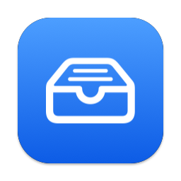

<div align="center">



# Holdit

**A quiet little copy center that lives in your menu bar.**

Drop anything in. Drag it back out whenever you need it.


</div>

---

Holdit sits next to your Wi‑Fi and Bluetooth icons. Click it and a panel drops down: drag in files, paste your clipboard, and pull items back out into Finder, Mail, a browser upload box or any other app. Everything stays put until **you** remove it, across quits, restarts and reboots.

## ✨ Features

|   |   |
|---|---|
| 🗂 **Holds copies, not originals** | Drop PDFs, Markdown, spreadsheets, images, folders or selected text. Your originals are never touched. |
| 📋 **One-click paste** | Turn whatever is on your clipboard (text, files or an image) into a new row. |
| ↗️ **Drag out anywhere** | Drag a row into any app. A fresh copy is handed over, so the item stays in your list. |
| 📌 **Panel that stays open** | Clicking elsewhere won't dismiss it. Hide it with ✕ or the tray icon. |
| ↕️ **Reorder** | Drag rows up and down to keep things in order. |
| 💾 **Persistent** | Your list survives quitting, restarting and rebooting. |
| 🪶 **Lightweight** | About 13 MB of RAM, 0% CPU when idle, no network access, no Dock icon. |

## 🚀 Getting started

**Requirements:** macOS 13 Ventura or later, and the Xcode Command Line Tools (`xcode-select --install`).

```sh
git clone https://github.com/faithere1/Holdit.git
cd Holdit
./build.sh
open Holdit.app
```

`build.sh` compiles the sources, renders the app icon and packages everything into `Holdit.app`. Move it to `/Applications` if you like.

> **Tip:** To launch Holdit automatically, add it under **System Settings → General → Login Items**.

## 🖱 Usage

| Action | How |
|---|---|
| Show / hide panel | Click the tray icon |
| Hide panel | Click ✕ in the panel |
| Add files | Drag them onto the panel |
| Add clipboard | Click **Paste** |
| Use an item | Drag the row out, or click its copy button |
| Open an item | Double-click the row |
| Show in Finder | Click the folder button on the row |
| Reorder | Drag rows up and down |
| Remove | Click the 🗑 on the row |
| Storage folder / Quit | Right-click the tray icon |

## 📁 Where your data lives

```
~/Library/Application Support/Holdit/
├── items.json   # the ordered list
└── files/       # private copies of dropped files
```

Copies take up real disk space, so clear out items you no longer need.

## 🧱 Project structure

```
Sources/
├── main.swift            # menu bar icon and panel
├── PanelView.swift       # the list UI (SwiftUI)
├── RowDragSource.swift   # dragging rows out to other apps
└── Store.swift           # copying, saving, paste, drag & drop
Tools/
└── make_icon.swift       # renders the app icon
build.sh                  # builds Holdit.app
```

Built with Swift, AppKit and SwiftUI only. No third-party dependencies.

## ⚠️ Known limitations

- Attachments dragged directly out of Apple Mail (file promises) may not drop in. Save them first, or copy them and use **Paste**.

---

<div align="center">
<sub>Made with care for a tidier desktop.</sub>
</div>
